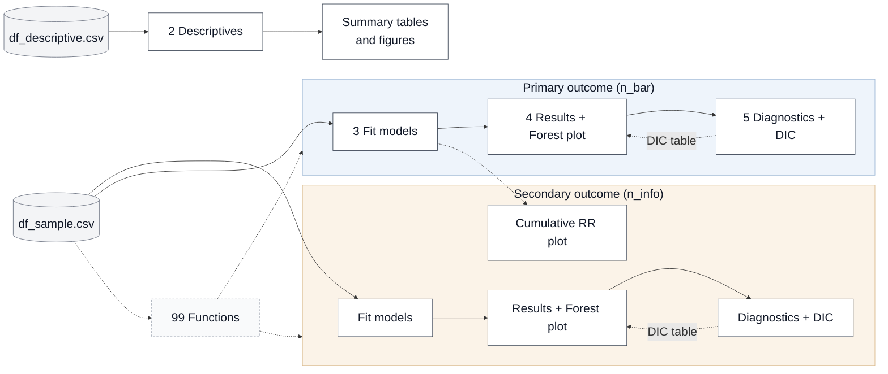

## Do journal policies reduce the use of bar graphs for visualizing continuous data? An observational study

Robert Schulz<sup>1</sup>, Teshome K. Deressa<sup>2,3</sup>, Adrian Barnett<sup>4</sup>, Yazid Zalia<sup>1</sup>, Teresa Cunha-Oliveira<sup>2,3</sup>, Camila Victoria-Quilla Baselly Heibrich<sup>1</sup>, Parya Abbasi<sup>1,5</sup>, Vladislav Nachev<sup>1</sup>, Tracey L. Weissgerber<sup>2,3</sup>

<sup>1</sup> *QUEST Center for Responsible Research, Berlin Institute of Health at Charité – Universitätsmedizin Berlin, Berlin, Germany*<br>
<sup>2</sup> *CIBB, Center for Innovative Biomedicine and Biotechnology, University of Coimbra, Coimbra, Portugal*<br>
<sup>3</sup> *CNC-UC, Center for Neuroscience and Cell Biology, University of Coimbra, Coimbra, Portugal*<br>
<sup>4</sup> *Australian Centre for Health Services Innovation and Centre for Healthcare Transformation, School of Public Health and Social Work, Faculty of Health, Queensland University of Technology, Brisbane, QLD, Australia*<br>
<sup>5</sup> *SYNLAB MVZ Berlin GmbH, Berlin, Germany*

---
- **Interactive dashboard:** [View the dashboard](https://excelscior-uc.github.io/journal-policy-dashboard/)
- **Preregistration:** [Open the preregistration](https://osf.io/tcyxg/overview)
- **Zenodo:** [](https://doi.org/10.5281/zenodo.23677882)
---

Code for an observational study evaluating whether journal editorial policies reduce the inappropriate presentation of continuous data with bar graphs and increase the use of more informative graphical displays. The analysis uses Bayesian hierarchical Poisson models fitted with the **nimble** package.

- **Primary outcome:** number of articles with bar graphs for continuous data (`n_bar`)
- **Secondary outcome:** number of articles with more informative graphs (`n_info`)

### Contents

- [Quick start](#quick-start)
- [Repository structure](#repository-structure)
- [Pipeline overview](#pipeline-overview)
- [Input data](#input-data)
- [Script reference](#script-reference)
- [Models](#models)
- [Naming conventions](#naming-conventions)
- [Outputs](#outputs)

### Quick start

1. Clone the repository and create the `data/`, `scripts/`, `results/` and `diagnostics/` folders locally.
2. Put the prepared datasets in `data/`: `df_descriptive.csv` (read by script 2) and `df_sample.csv` (read by scripts 3 and 6 and by `99_functions.R`).
3. Open the project as an **RStudio Project**. The **here** package needs this to resolve paths from the repository root.
4. Install the required packages (developed and tested under R 4.5.1):

```r
   install.packages(c("nimble", "coda", "posterior", "dplyr", "tidyr", "tidyverse", "ggplot2", "readr", "purrr", "stringr",
                      "scales", "here", "openxlsx", "ggh4x", "patchwork", "fs", "viridis"))
```

5. Run the scripts in `scripts/`.

### Repository structure

```text
.
├── data/          # Prepared datasets (df_sample.csv, df_descriptive.csv)
├── scripts/       # All analysis R scripts (numbered pipeline order)
├── results/       # Model outputs, summary tables, figures
└── diagnostics/   # MCMC diagnostics (trace/density/ACF PDFs, DIC summaries)
```

### Pipeline overview

| Script | Purpose |
|:---|:---|
| `99_functions.R` | Shared helper functions: model fitting, posterior summaries, MCMC diagnostics, and outcome-specific DIC functions (`compute_dic_bar()` / `compute_dic_info()`, `build_dic_bar_table()` / `build_dic_info_table()`). |
| `2__descriptives.R` | Descriptive summary tables and exploratory figures. |
| `3__models.R` | Fits the seven candidate Bayesian Poisson models for `n_bar`. |
| `4__results.R` | Posterior summary tables (with ESS and R-hat) and the forest plot. |
| `5__diagnostics.R` | MCMC diagnostics (trace, density, ACF), DIC per model, and the DIC comparison table for `n_bar`. |
| `6__sensitivity.R` | Refits all seven models for `n_info`, runs their summaries, diagnostics, DIC table and forest plot, and builds the cumulative rate-ratio plot. |

**Run order:** 2 → 3 → 5 → 4 → 6. The forest plot in script 4 reads `results/dic_comparison_bar.csv`, which script 5 writes, so run script 5 first (or rerun script 4 afterwards). Script 6 is self-contained for the secondary outcome, so there is no need to loop back through scripts 4 and 5.

#### Pipeline flowchart



Solid arrows show the order of the steps. The dotted "DIC table" arrows show that the forest plot needs the DIC table, so the diagnostics/DIC step has to be run first (see run order above). `df_sample.csv` is used by scripts 3 and 6 (and by `99_functions.R` to compute DIC); `df_descriptive.csv` is used only by script 2. The secondary outcome repeats the primary workflow separately inside script 6; its cumulative rate-ratio plot is the only part that reuses the primary (`n_bar`) samples from script 3 (dotted arrow from "3 Fit models"). Dotted arrows from `99 Functions` show it being sourced by scripts 3–6.

### Input data

| File | Description |
|:---|:---|
| `df_descriptive.csv` | Journal-year-level data for descriptive summaries, including counts of articles excluded from the main analysis. |
| `df_sample.csv` | Journal-year-level data restricted to articles containing bar graphs for continuous data, informative visualizations, or both. Used for the primary and secondary analyses. |

#### Data dictionary

| Variable | Definition |
|:---|:---|
| `field` | Subject field of the journal. |
| `journal` | Journal name. |
| `year` | Publication year (2010–2025). |
| `policy_ref` | `1` = treated journal (adopted the policy during the study period); `0` = control journal (never adopted).|
| `year_policy_started` | Year the policy was adopted; missing if none recorded. |
| `policy` | `1` = journal-year in or after the adoption year; `0` = pre-adoption years and all control-journal years. |
| `year_since_policy` | Time since adoption: `0` before adoption or if no adoption year; `1` in the adoption year; `2` the following year, and so on. |
| `year_centered` | `year - mean(year)` across the aggregated dataset. |
| `log_offset` | Exposure offset in applicable count models. |
| `bar_specificity` | Policy-strength variable: specificity of the journal's bar-graph guidance. |
| `recommendation` | Policy-strength variable: coded recommendation category. |
| `sample_size` | Policy-strength variable: coded sample-size category. |
| `n_bar` | Articles with at least one bar graph for continuous data (each article counted once). |
| `n_info` | Articles with at least one informative visualization: bar-dot, box, dot, histogram or violin plot. |
| `n_bar_or_info` | Unique articles with bar graphs, informative visualizations, or both. Denominator for the primary analysis. |
| `n_both` | Articles with both bar graphs and informative visualizations. |
| `n_bar_xor_info` | Articles with exactly one category (bar graphs or informative visualizations, not both). |


### Script reference

#### `99_functions.R`

Sourced by scripts 3–6. Besides the model-fitting and diagnostic helpers (`build_and_run_pois()`, `summarise_model()`, `save_trace_density()`, `save_acf_plot()`), it holds the DIC functions, which are split by outcome:

| Outcome | DIC per model | DIC comparison table | Output |
|:---|:---|:---|:---|
| Primary (`n_bar`) | `compute_dic_bar()` | `build_dic_bar_table()` | `results/dic_comparison_bar.csv` |
| Secondary (`n_info`) | `compute_dic_info()` | `build_dic_info_table()` | `results/dic_comparison_info.csv` |

- The DIC functions pick the matching outcome data (`dic_data_bar` / `dic_data_info`) and the model-specific log-likelihood (non-nested, 3-level nested, or field hierarchy) automatically, so nothing needs to be commented or uncommented to switch outcome.
- `compute_dic_bar()` stops if the label contains `_info_`, and `compute_dic_info()` stops if it does not. The table builders use `_info_` in the label to separate the two outcomes when they discover saved DIC files.

#### `2__descriptives.R`

Reads `data/df_descriptive.csv`, recodes field names for publication, and produces descriptive summaries and plots (journal-sample counts, policy adoption, follow-up).

**Writes to `results/`:**

- `summary_table.csv`: overall and by-policy-group counts and percentages of bar-only, informative-only, both, and excluded articles.
- `policy_timeline_plot.pdf`: timeline of journal policy adoption patterns.
- `stacked_by_field.pdf`: horizontal stacked bar chart of graph-type usage by field.
- `policy_by_year.pdf` / `nonpolicy_by_year.pdf`: temporal trends in graph-type proportions by field, for policy vs. non-policy journals, with adoption-year markers.

#### `3__models.R`

Fits the seven Bayesian hierarchical Poisson models (see [Models](#models)) to the primary outcome, reading `data/df_sample.csv`.

**Writes to `results/`:**

- `samples_<label>.rds`: per-chain posterior samples and WAIC.
- `mcmc_list_<label>.rds`: the same samples as a `coda` `mcmc.list`.

Labels follow `model1A_pois_60k`, `model1B_pois_60k`, `model2_pois_60k`, …, `model6_pois_60k` (the number is `mcmc_niter` in thousands).

#### `4__results.R`

Loads the fitted models from `results/` and produces the summary tables and forest plot for the primary outcome. Requires `mcmc_niter`.

- Calls `summarise_model()` for each of the 7 models (posterior mean, SD, 95% credible interval, ESS and R-hat for key parameters) → `results/summary_<model_label>.csv`.
- Draws a forest plot of time and policy rate ratios across all models, ordered by DIC → `results/forest_plot_bar_two_panels_vertical.pdf`. **Requires `results/dic_comparison_bar.csv` from script 5.**
- The cumulative rate-ratio plot and the secondary-outcome forest plot are built in `6__sensitivity.R`, not here.

#### `5__diagnostics.R`

For each of the 7 primary outcome models, loads the MCMC and sample objects from `results/` (requires `mcmc_niter`) and:

- saves trace and posterior density plots for key parameters (`save_trace_density()`) → `diagnostics/trace_plots_<label>.pdf`, `diagnostics/density_plots_<label>.pdf`;
- saves autocorrelation plots (`save_acf_plot()`) → `diagnostics/acf_<label>.pdf`;
- computes DIC (`compute_dic_bar()`, with model-specific log-likelihood functions for the non-nested, 3-level nested and field-hierarchy structures) → `results/dic_<label>.rds`, `diagnostics/dic_<label>.txt`;
- collates all primary outcome DIC results with `build_dic_bar_table()`, ranked by DIC with ΔDIC → `results/dic_comparison_bar.csv`.

#### `6__sensitivity.R`

**Secondary-outcome models.** Refits the same 7 model structures as script 3 with `n_info` as the outcome. Labels are suffixed `_info_pois_60k` (e.g. `model1A_info_pois_60k`); outputs follow the same pattern as script 3.

**Results, diagnostics and forest plot (secondary outcome).**

- **Results:** `summarise_model()` for each model → `results/summary_<label>.csv`.
- **Diagnostics:** trace, density and ACF plots (same functions as script 5) and DIC per model with `compute_dic_info()` → `diagnostics/`, then `build_dic_info_table()` → `results/dic_comparison_info.csv`.
- **Forest plot:** time and policy rate ratios, ordered by DIC → `results/forest_plot_info_two_panels_vertical.pdf`.

**Cumulative rate-ratio plot.** Builds cumulative rate-ratio curves for the 7 *primary outcome* models over −3 to +3 years relative to policy adoption, using the joint posterior draws of the time (`beta`) and policy (`gamma`) effects. Step-change models (1A–3) are solid and gradual-change models (4–6) are dashed → `results/cumulative_rr_policy_event_time_joint.pdf`. This needs the primary models from script 3.

### Models

| Model | Policy effect | Description |
|:---|:---|:---|
| 1A | Step change | Base Poisson, journal random intercepts and slopes, observation-level overdispersion |
| 1B | Step change | Same as 1A without overdispersion |
| 2 | Step change | Fixed time trend, journal random intercepts only |
| 3 | Step change | Journals nested within fields, random slopes |
| 4 | Gradual change | Fixed time trend, random intercepts |
| 5 | Gradual change | Journal-specific time trends |
| 6 | Gradual change | Field hierarchy + journal-specific time trends |

### Naming conventions

Model labels are `model<ID>_pois_<k>k` for the primary outcome and `model<ID>_info_pois_<k>k` for the secondary outcome, where `<ID>` is `1A`, `1B`, `2`, …, `6` and `<k>` is `mcmc_niter` in thousands. The model ID is written with an **upper-case** `A`/`B` throughout the code (labels, file names, objects), because the forest plots match the DIC tables to the model names (`model1A`, `model1B`) by this label. If you have result files from an earlier run with lower-case labels (e.g. `samples_model1a_pois_60k.rds`), rename them or rerun the models.

### Outputs

| Folder | Contents |
|:---|:---|
| `results/` | Fitted samples (`.rds`), `coda` objects, summary and DIC tables (`.csv`), figures (`.pdf`) |
| `diagnostics/` | Trace, density and ACF plots (`.pdf`), DIC text summaries (`.txt`) |
